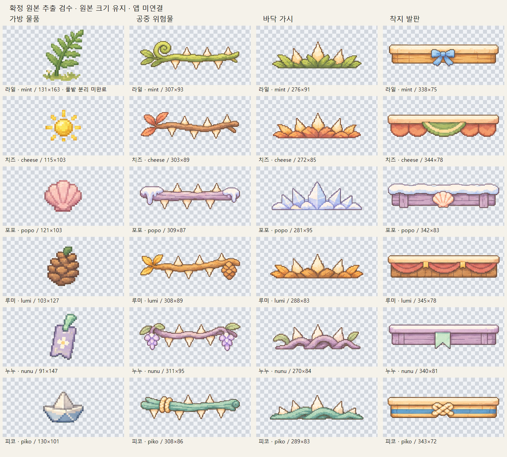
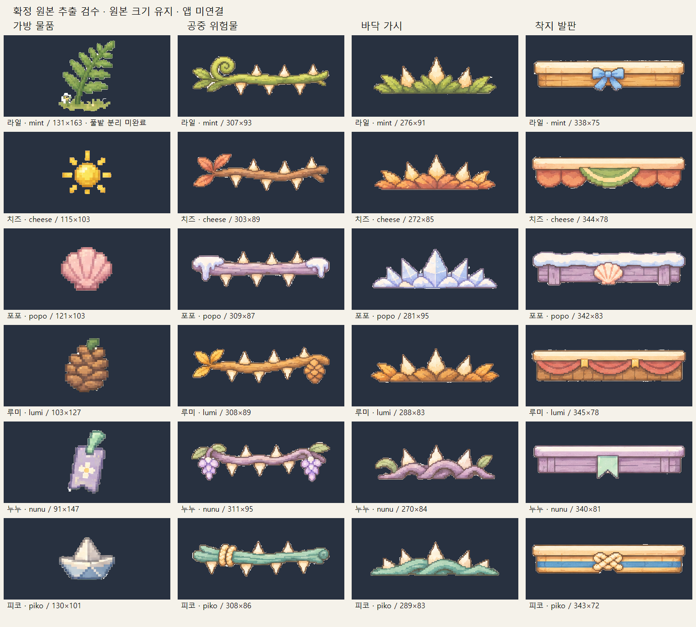

# 확정 가방·장애물 디자인 납품 — 2026-11-12

**디자인 자료만 준비했다. 게임 적용·실행·기기 검수는 하지 않았다.** `integrated=false`.

## 납품 상태

- 원본 2장: 첨부 파일을 바이트 그대로 보관했다. 이전 시안으로 대체하지 않았다. 원본의 배치·색·도트는 변경하지 않았다.
- 공중 장애물 6개 + 바닥 가시 6개 + 발판 6개 = 투명 PNG 18개.
- 가방 물품 단독 PNG 5개 + 고사리 잎의 풀밭 포함 참고 PNG 1개. **라일의 고사리 잎은 단독 분리 미완료**다. `pending/`에서 별도 보관하며 완성 물품으로 사용하지 않는다.
- 그림 자체를 체크무늬/어두운 배경에서 확인했다. 글자·숫자·동물 얼굴·버튼·표 테두리는 추출물에 포함하지 않았다. 고사리 참고본의 풀밭/꽃은 남아 있다.
- 밝은 가시, 포포의 눈/얼음, 발판의 밝은 윗면, 물품의 밝은 무늬를 육안 대조했다. 밝은 색을 일괄 투명 처리하지 않았다.

## 미리보기

## 원본

| 파일 | 크기 | 첨부 원본 |
| --- | --- | --- |
| [bag-approved-20261112.png](bag-approved-20261112.png) | 1672×941 | ChatGPT Image 2026년 11월 12일 오전 12_58_44.png |
| [obstacles-approved-20261112.png](obstacles-approved-20261112.png) | 1586×992 | 길 위의 작은 모험 장애물 도감(1).png |

## 개별 파일 목록

모든 크기는 PNG 실제 픽셀이다. 원본 크기로 추출했고 사방 4px 투명 여백을 추가했다. 통일된 게임 셀 규격으로 축소하지 않았다. ID는 기존 계약을 유지한다.

| 캐릭터 | 구분·용도 | 파일 | 크기 | 상태 |
| --- | --- | --- | --- | --- |
| mint=라일 | 고사리 잎 | [bag_mint_with_ground.png](pending/bag_mint_with_ground.png) | 131×163 | 풀밭 포함 / 단독 분리 미완료 |
| mint=라일 | 공중 위험물 디자인 | [air_mint.png](extracted/air_mint.png) | 307×93 | 디자인 추출본 |
| mint=라일 | 바닥 위험물 디자인 | [spikes_mint.png](extracted/spikes_mint.png) | 276×91 | 디자인 추출본 |
| mint=라일 | 밝고 평평한 윗면에 착지하는 발판 디자인 | [platform_mint.png](extracted/platform_mint.png) | 338×75 | 디자인 추출본 |
| cheese=치즈 | 햇빛 조각 | [bag_cheese.png](extracted/bag_cheese.png) | 115×103 | 디자인 추출본 |
| cheese=치즈 | 공중 위험물 디자인 | [air_cheese.png](extracted/air_cheese.png) | 303×89 | 디자인 추출본 |
| cheese=치즈 | 바닥 위험물 디자인 | [spikes_cheese.png](extracted/spikes_cheese.png) | 272×85 | 디자인 추출본 |
| cheese=치즈 | 밝고 평평한 윗면에 착지하는 발판 디자인 | [platform_cheese.png](extracted/platform_cheese.png) | 344×78 | 디자인 추출본 |
| popo=포포 | 조개껍데기 | [bag_popo.png](extracted/bag_popo.png) | 121×103 | 디자인 추출본 |
| popo=포포 | 공중 위험물 디자인 | [air_popo.png](extracted/air_popo.png) | 309×87 | 디자인 추출본 |
| popo=포포 | 바닥 위험물 디자인 | [spikes_popo.png](extracted/spikes_popo.png) | 281×95 | 디자인 추출본 |
| popo=포포 | 밝고 평평한 윗면에 착지하는 발판 디자인 | [platform_popo.png](extracted/platform_popo.png) | 342×83 | 디자인 추출본 |
| lumi=루미 | 솔방울 | [bag_lumi.png](extracted/bag_lumi.png) | 103×127 | 디자인 추출본 |
| lumi=루미 | 공중 위험물 디자인 | [air_lumi.png](extracted/air_lumi.png) | 308×89 | 디자인 추출본 |
| lumi=루미 | 바닥 위험물 디자인 | [spikes_lumi.png](extracted/spikes_lumi.png) | 288×83 | 디자인 추출본 |
| lumi=루미 | 밝고 평평한 윗면에 착지하는 발판 디자인 | [platform_lumi.png](extracted/platform_lumi.png) | 345×78 | 디자인 추출본 |
| nunu=누누 | 책갈피 | [bag_nunu.png](extracted/bag_nunu.png) | 91×147 | 디자인 추출본 |
| nunu=누누 | 공중 위험물 디자인 | [air_nunu.png](extracted/air_nunu.png) | 311×95 | 디자인 추출본 |
| nunu=누누 | 바닥 위험물 디자인 | [spikes_nunu.png](extracted/spikes_nunu.png) | 270×84 | 디자인 추출본 |
| nunu=누누 | 밝고 평평한 윗면에 착지하는 발판 디자인 | [platform_nunu.png](extracted/platform_nunu.png) | 340×81 | 디자인 추출본 |
| piko=피코 | 종이배 | [bag_piko.png](extracted/bag_piko.png) | 130×101 | 디자인 추출본 |
| piko=피코 | 공중 위험물 디자인 | [air_piko.png](extracted/air_piko.png) | 308×86 | 디자인 추출본 |
| piko=피코 | 바닥 위험물 디자인 | [spikes_piko.png](extracted/spikes_piko.png) | 289×83 | 디자인 추출본 |
| piko=피코 | 밝고 평평한 윗면에 착지하는 발판 디자인 | [platform_piko.png](extracted/platform_piko.png) | 343×72 | 디자인 추출본 |

## 개발팀 전달사항

1. 가방 시안의 코인 수량(75), 물품 수량(5개/0개), 전달 가능 조건, 문구와 버튼은 예시다. 이미지 숫자를 하드코딩하지 말고 실제 데이터·동작에 연결한다.
2. 시안의 토끼·고양이·강아지 같은 다른 동물 얼굴은 그대로 쓰지 않는다. 해당 ID의 기존 실제 캐릭터 스프라이트로 교체한다. 라일 ID는 `mint`다.
3. 공중 장애물(`air`)과 바닥 가시(`spikes`)는 위험물이다. 발판(`platform`)의 밝고 평평한 윗면은 착지 대상이다. 도트 그림의 테두리나 장식 전체를 곧바로 충돌 영역으로 쓰지 않는다.
4. 게임 적용·스케일/좌표·충돌 판정 조정·튜토리얼 연결·실행 검증은 B 개발팀 담당이다. 이 납품에는 앱 리소스 설치, 코드, 물리 수치, 충돌 도형을 포함하지 않는다.
5. 가방의 배치/색과 장애물의 작은 도트 느낌은 승인 원본을 기준으로 한다. 이전 `obstacle-concepts` 또는 기존 18개 소품 스프라이트로 대체하지 않는다. 기존 소품과 이번 공중/가시/발판은 용도가 다르다.

## 미완료·추출 한계

- **고사리 잎 물품 단독 분리 미완료:** 줄기 하단과 풀밭이 같은 녹색으로 이어진 평면 그림이다. 경계를 임의로 잘라 줄기를 훼손하거나 아래를 다시 그리지 않았다. `pending/bag_mint_with_ground.png`는 원본 장식을 포함한 참고본이다. A가 분리 레이어/투명 원본 또는 명확한 줄기 경계를 확보한 뒤 완료할 수 있다.
- 어두운 미리보기에서 일부 외곽에 얇은 밝은 가장자리가 보인다. 원본의 종이색과 섞인 외곽 픽셀을 원색 그대로 남겼기 때문이다. **완전한 외곽 색 분리/매팅은 미완료**이며 색을 새로 칠하거나 번지게 보정하지 않았다. 원본 RGB 보존과 완전한 무테 투명화를 동시에 보장할 수 없는 평면 원본의 한계다.
- 가방 물품의 풀밭에 가려진 부분은 추정해서 복원하지 않았다. 화면에서 보이는 부분을 분리한 자료이며 숨겨진 완전한 원화를 새로 만든 것이 아니다.
- 추출 상태는 디자인 자료 준비 여부이며 게임 사용 승인, 적정 표시 크기, 실제 배경과의 대비 또는 충돌/착지 정확성 판정이 아니다.

## 수행한 이미지 검사

- 원본 2장의 SHA-256이 첨부 파일과 동일함을 확인했다.
- 개별 PNG 24개 파일 열기, 알파 0/255, 4px 투명 여백, 파일 누락 없음 확인. 각 불투명 픽셀의 RGB가 manifest 원본 좌표와 정확히 같음을 대조했다. 리사이즈·새 그림 생성·색보정 없음.
- 원본 두 장과 체크무늬/어두운 전체 미리보기를 대조하여 잘림·글자/표 테두리·밝은 부분과 위 미완료 항목을 확인했다. PNG 해시·크기·캐릭터 대응·원본 영역은 `manifest.json`에 있다.
- 앱 코드 수정, 게임/에뮬레이터 실행, APK 빌드, 게임 기능/충돌 테스트, 튜토리얼 연결은 **수행하지 않았다**.

## 게시 범위

최신 main `c78a46b`에서 분리한 `codex/approved-bag-obstacles` 브랜치에 `docs/art/approved/`만 게시한다. 원래 미커밋 작업/인덱스를 건드리지 않는다. 원본 2개, 개별 PNG 24개(미완료 참고본 1개 포함), 미리보기 2개, 이 문서와 manifest 총 30파일이다. 추출용 임시 도구·캐시·앱 파일은 포함하지 않는다. main 직접 병합·강제 push는 하지 않는다.
