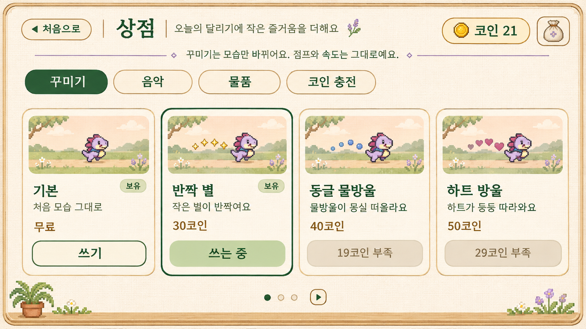

# 상점 디자인 전달 패키지

기준일: 2026-11-12 (한국). 사용자 승인: 크림색 천·밝은 나무·초록 버튼으로 정리한 상점 시안.

## 포함 자료와 완료 범위
- `approved/shop-approved.png`: 승인 원본. 재생성·보정 없이 보관한 디자인 참고 이미지.
- `DESIGN_SPEC.md`: 배치, 상태, 탭별 적용 기준과 역할 분담.
- `DEVELOPER_PROMPT.txt`: 개발 담당자에게 전달할 구현 요청.
- `source.json`: 원본 식별, 이미지 크기, SHA-256.

이 패키지는 **디자인 자료**다. 앱에 바로 넣을 투명 스프라이트·9-patch·레이어 파일은 아니다. 앱 코드 적용, 빌드, APK 생성, 에뮬레이터 실행, 게임 기능 검증은 수행하지 않았다. 개발 담당자가 진행한다.

시각 승인된 화면은 **꾸미기 탭 1장**이다. 음악·물품·코인 충전은 같은 UI 체계를 적용하는 전달 지침이며 별도 승인 시안이 완성된 것으로 표시하지 않는다.

숫자와 상태는 예시다. 21코인과 시안 가격을 하드코딩하거나 실제 잔액·가격·보유 상태를 변경하지 않는다. 생성된 캐릭터 그림도 실제 게임 스프라이트를 교체하는 자산이 아니다.

디자인 담당: 시안과 안내 전달. 개발 담당: UI 재구성, 데이터 연결, 기기별 대응, 기능 검증.
